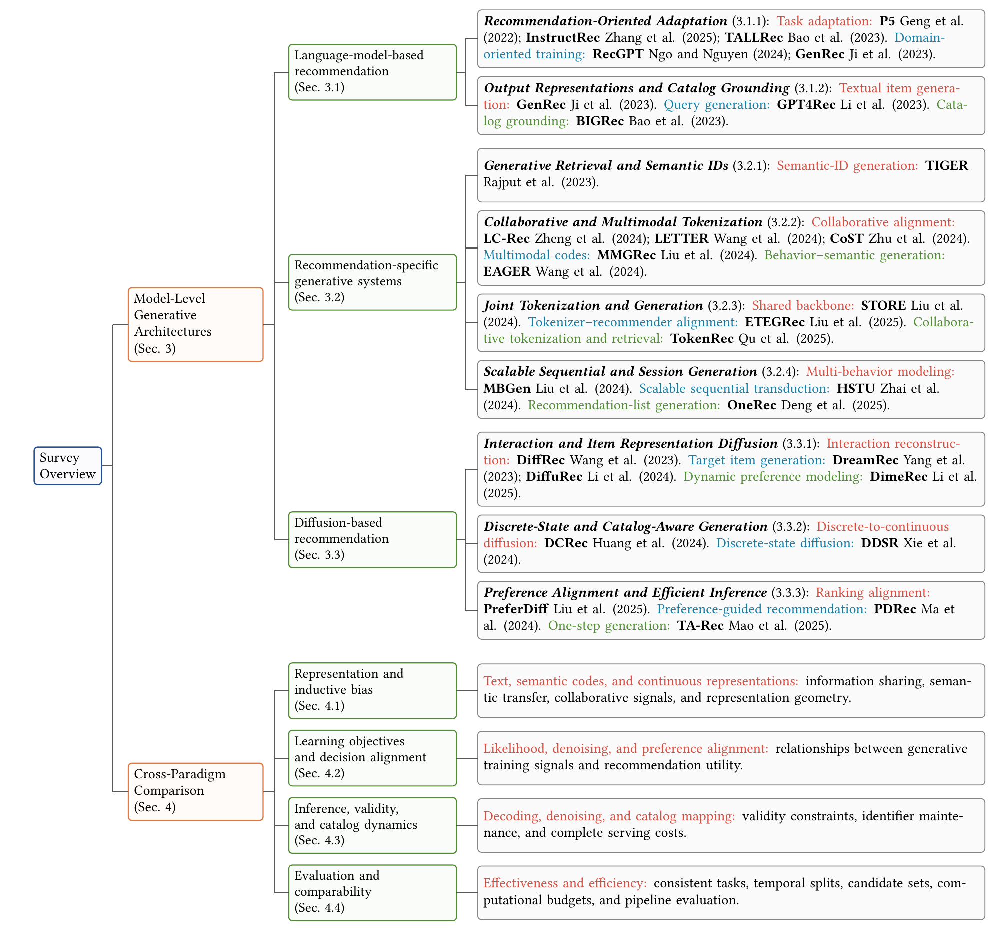

# 生成式推荐系统综述

**Generative Models as Recommendation Engines: A Survey of Architectures, Representations, and Learning Paradigms**

作者：Mingyu Lin、Shunyang Huang。

- **阅读论文：[完整PDF](output/survey.pdf)**。
- **修改正文：[main.tex](main.tex)**；参考文献在[references.bib](references.bib)。
- **查看分类总览：[高清PDF](figures/overview.pdf) / [PNG](figures/overview.png)**；图源在[figures/overview.tikz](figures/overview.tikz)。



## 目录说明

```text
survey/
├── README.md                  # 阅读与构建入口
├── main.tex                   # 完整论文正文，编辑这份文件
├── references.bib             # 参考文献
├── figures/
│   ├── overview.tikz          # 总览图的可编辑TikZ源文件
│   ├── overview.tex           # 单独编译总览图的LaTeX入口
│   ├── overview.pdf           # 正文引用的矢量图
│   ├── overview.png           # 仓库页面使用的图预览
│   ├── paradigms.{tikz,tex,pdf}    # 图2：四类推荐流程对比（手写TikZ）
│   └── semantic_id.{tikz,tex,pdf}  # 图3：残差量化与Semantic ID前缀树（手写TikZ）
├── styles/                    # 随文提供的ACM文档类与参考文献样式
├── scripts/
│   ├── build.py               # 编译全部插图和完整论文
│   └── generate_overview.py   # 从脚本中的分类结构与文献库生成TikZ源文件
├── output/
│   └── survey.pdf             # 可直接阅读的完整论文
├── review/                    # 历史校对截图，非正文插图
└── build/                     # 本地编译中间文件及日志，不提交到Git
```

## 本地构建

需要Python 3和TeX Live（含`latexmk`、`pdflatex`、`bibtex`）。LaTeX依赖包括`acmart`所需宏包、TikZ、`standalone`、`libertine`等；本目录已提供`acmart.cls`和`ACM-Reference-Format.bst`，字体和其他宏包由TeX发行版提供。

从仓库根目录运行：

```bash
python3 survey/scripts/build.py
```

脚本先编译`figures/`下的三张插图（`overview`、`paradigms`、`semantic_id`），再编译正文和参考文献，生成对应的`figures/*.pdf`与`survey/output/survey.pdf`。所有辅助文件和构建日志写入`survey/build/`。

若TeX Live不在`PATH`中，可以指定二进制目录：

```bash
python3 survey/scripts/build.py --tex-bin /path/to/texlive/bin/x86_64-linux
```

原课程工作区若已有`.tools/texlive`，脚本也会自动识别；从GitHub克隆后只需使用自己的TeX安装，不依赖未上传的课程脚本或旧稿。

## 修改与更新总览图

直接修改`figures/*.tikz`后，运行以下命令仅重编译插图：

```bash
python3 survey/scripts/build.py --figure-only
```

若要修改分类条目或依据文献库更新作者、年份，编辑`scripts/generate_overview.py`中的分类定义及`references.bib`，然后执行：

```bash
python3 survey/scripts/build.py --regenerate-figure
```

`--regenerate-figure`会覆盖`overview.tikz`和`overview.tex`，不会覆盖论文正文；手动修改图源后不要随意使用该选项。

`overview.png`是供仓库阅读的静态预览。更新矢量图后，如已安装Poppler，可用以下命令刷新PNG：

```bash
pdftoppm -singlefile -png -r 150 survey/figures/overview.pdf survey/figures/overview
```

## 文件来源

此前的`survey_tree_preview.tex`已经是完整论文，本次统一命名为`main.tex`；对应PDF移至`output/survey.pdf`。`survey_overview_tree.*`统一归入`figures/overview.*`。

旧的`.aux`、`.log`、`.fls`、`.bbl`等中间文件在本地`build/legacy/`保留，已停止Git跟踪；无需手动编辑。校对截图见[review说明](review/README.md)，阅读当前论文以`output/survey.pdf`为准。
